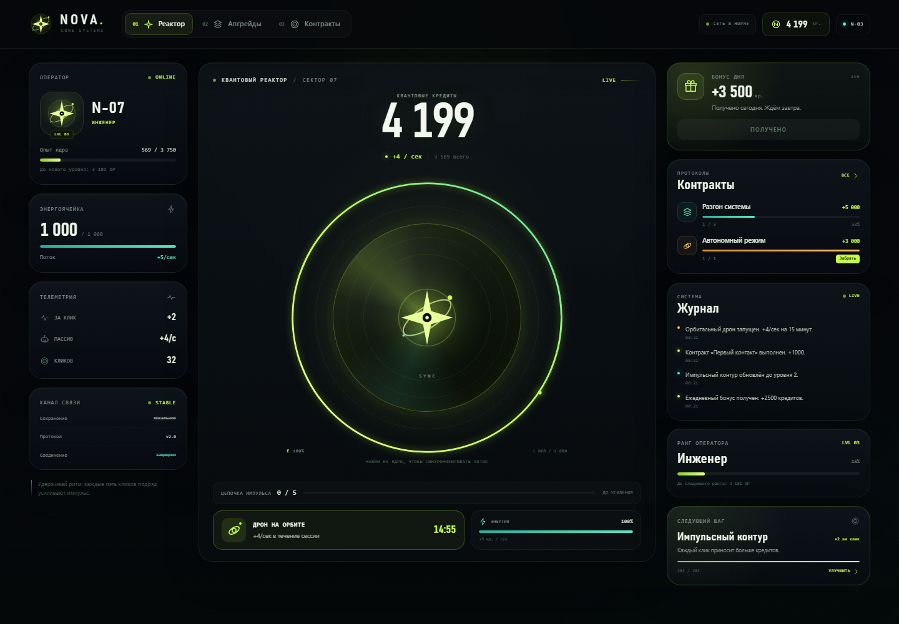
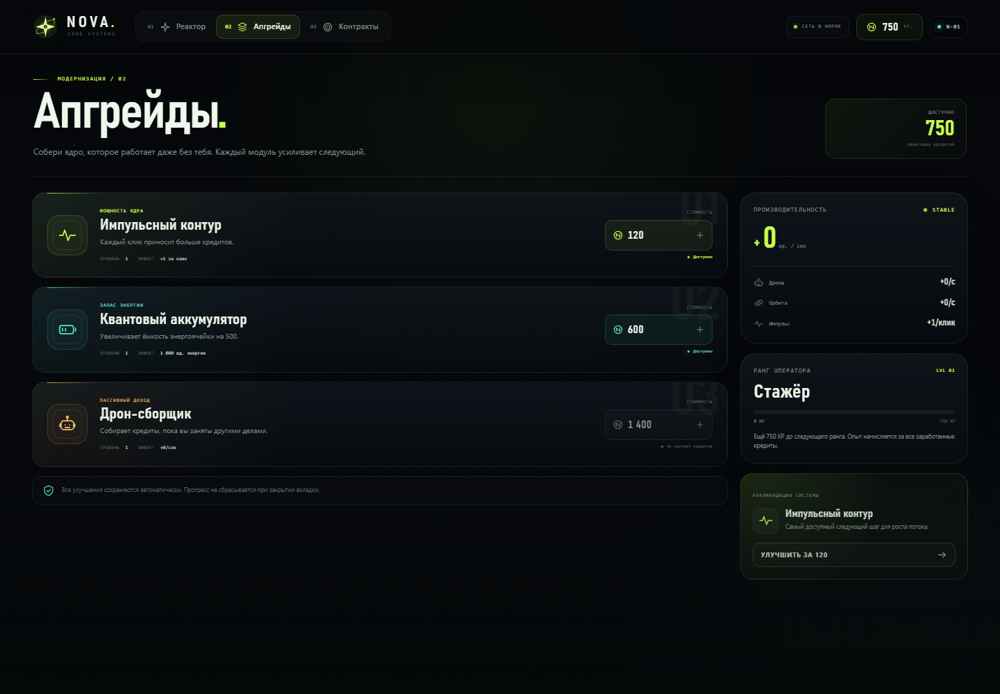
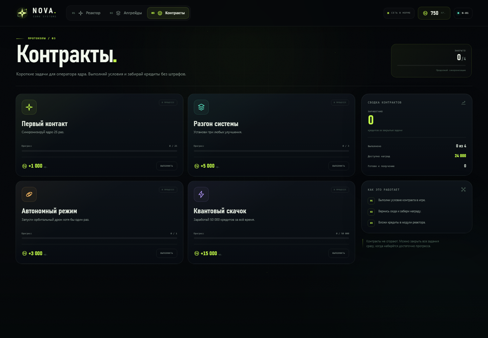
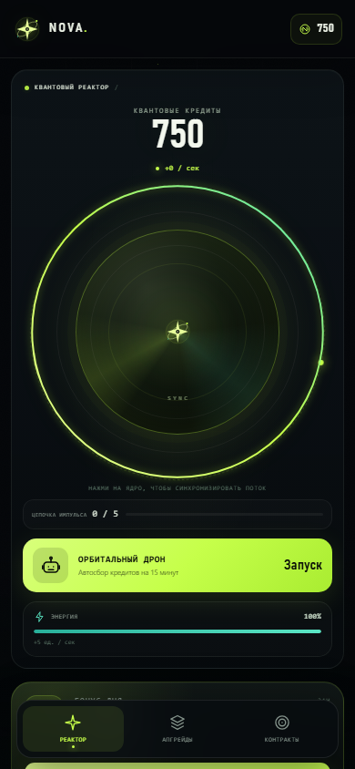

# NOVA CORE

**Квантовый кликер с характером.** Нажимай на ядро, собирай комбо, прокачивай модули и отправляй дронов за кредитами.

Дизайн и логотип сделаны с нуля: тёмный HUD-интерфейс, кислотный лайм, орбитальное ядро и собственная SVG-марка NOVA.



## Что внутри

- **Реактор** — клик по ядру, энергия, цепочка импульса до ×2 и живые всплывающие награды.
- **Три модуля прокачки** — импульсный контур, квантовый аккумулятор и дрон-сборщик. Бесконечные уровни и растущая стоимость.
- **Орбитальный дрон** — пассивный доход на 15 минут.
- **Контракты** — четыре задания с прогрессом и наградами.
- **Бонус дня** — ежедневная награда, зависящая от ранга.
- **Ранг оператора** — опыт за все заработанные кредиты и шесть званий.
- **Автосохранение** — прогресс хранится в `localStorage`, есть миграция со старой версии и офлайн-доход.
- **Адаптивность** — три колонки на десктопе и нижняя навигация на мобильных.
- **Доступность** — семантические кнопки, `aria`-атрибуты, видимый фокус и поддержка `prefers-reduced-motion`.

## Экраны

| Апгрейды | Контракты |
| --- | --- |
|  |  |

<p align="center">
  
</p>

## Стек

- React 19
- Vite 8
- Framer Motion
- Чистый CSS: без UI-библиотек и CSS-фреймворков
- Собственная SVG-графика: логотип, favicon и иконки

## Запуск

```bash
npm install
npm run dev
```

Приложение откроется на `http://localhost:5173`.

### Сборка

```bash
npm run build
npm run preview
```

### Проверка кода

```bash
npm run lint
```

## Как играть

1. Нажимай на центральное ядро — каждый клик тратит 1 единицу энергии и приносит кредиты.
2. Пять быстрых кликов подряд усиливают множитель. После паузы цепочка сбрасывается.
3. В магазине покупай улучшения: они увеличивают доход за клик, запас энергии и пассивный доход.
4. Запускай дрон на 15 минут, чтобы получать кредиты автоматически.
5. Закрывай контракты и забирай ежедневный бонус, чтобы быстрее расти в ранге.

## Сохранение и сброс

Прогресс хранится в ключе `nova-core-save-v2`. Чтобы начать заново, выполни в консоли браузера:

```js
localStorage.removeItem('nova-core-save-v2');
location.reload();
```

## Структура

```text
src/
  components/     # логотип и SVG-иконки
  game/           # конфигурация, экономика, состояние и сохранения
  pages/          # реактор, апгрейды, контракты
  App.jsx         # оболочка, навигация, тосты
  index.css       # дизайн-система и адаптивность
public/
  favicon.svg     # фирменная иконка
.github/
  workflows/      # деплой на GitHub Pages
```

## GitHub Pages

В репозитории уже есть workflow `.github/workflows/deploy.yml`. После пуша в `main`:

1. Открой **Settings → Pages**.
2. В разделе **Build and deployment** выбери **GitHub Actions**.
3. Дождись завершения workflow — сайт будет доступен по адресу вида `https://<username>.github.io/nova-core/`.

---

Сделано как самостоятельный проект: код, интерфейс, логотип и анимации.
